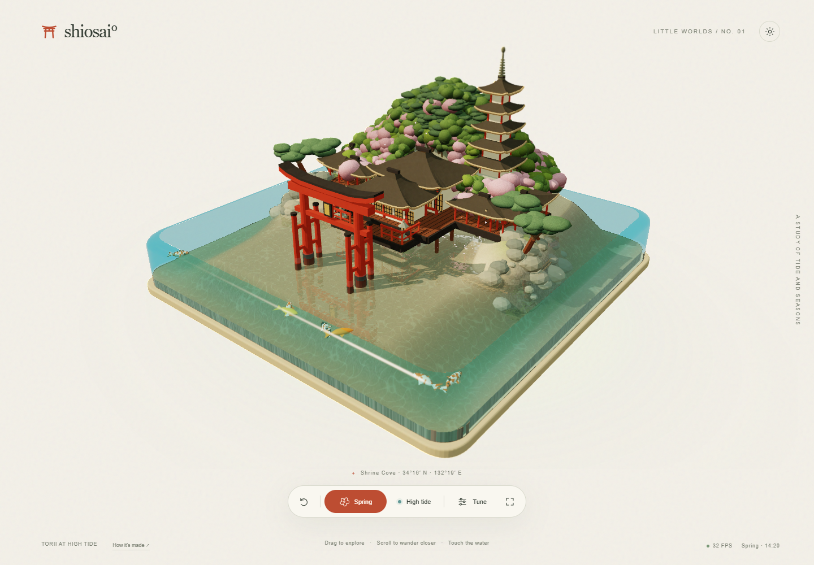
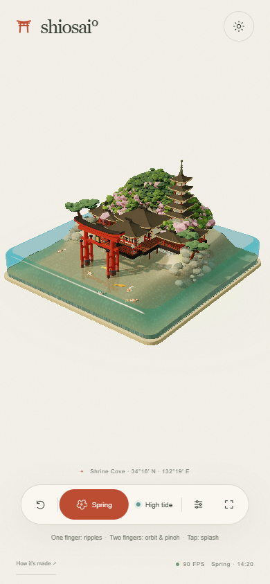

# shiosai° — Torii at High Tide

一座可互動的日本神社島嶼：四季、潮汐、水面漣漪、飄落的花瓣與自由游動的錦鯉。支援桌機及手機觸控。

場景採用置中、放大的完整模型視角，依螢幕比例調整取景，保留底部操作列。

**[開啟線上作品](https://jjuyp.github.io/shiosai/)** · GitHub Pages 公開網站，手機及桌機均可開啟，不需要登入。



## 開啟方式

下載本儲存庫，以支援 WebGL 2 的瀏覽器開啟 `index.html`。所有場景程式、CSS、介面及著色器都在這個檔案內，不需要 npm 安裝或建置。

需要網路載入 Three.js **r160**、OrbitControls 及 BufferGeometryUtils。模型、材質花紋、地形、植被和水波均由程式生成，沒有外部模型或圖片依賴。

也可以在儲存庫目錄啟動本機靜態伺服器：

```sh
python -m http.server 8000
```

然後開啟 `http://localhost:8000`。

## 操作

| 操作 | 桌機 | 手機 |
| --- | --- | --- |
| 玩水／產生漣漪 | 移動滑鼠經過水面 | 單指滑過水面 |
| 激起水花、驚動錦鯉 | 點擊水面 | 輕點水面 |
| 旋轉視角 | 拖曳 | 雙指移動 |
| 縮放 | 滾輪 | 雙指捏合 |
| 換季、潮汐與設定 | 底部控制列 | 底部控制列 |



## 檔案

- `index.html`：完整應用程式，可直接修改。
- `assets/`：說明文件使用的實際瀏覽器截圖，不是應用程式依賴。
- `docs/mobile.md`：手機操作及線上存取說明。
- `docs/validation.md`：功能驗證與效能測試範圍。
- `docs/*verification.json`：測試數值摘要。

手機介面已通過 Chrome 觸控模擬測試，包括 375 px、390 px 直向與橫向配置；尚未在實體 iPhone、Android 或 Safari 上測試。模擬的 FPS 不代表實體手機效能。

## 部署

這是靜態單頁作品，使用 GitHub Pages 發布 `main` 分支根目錄。推送到 `main` 後，GitHub 會自動重新部署。`.nojekyll` 讓檔案直接以靜態資源發布。

## 相依套件

[Three.js](https://github.com/mrdoob/three.js) 採用 MIT 授權；本作品透過 jsDelivr import map 載入指定 r160 版本。
